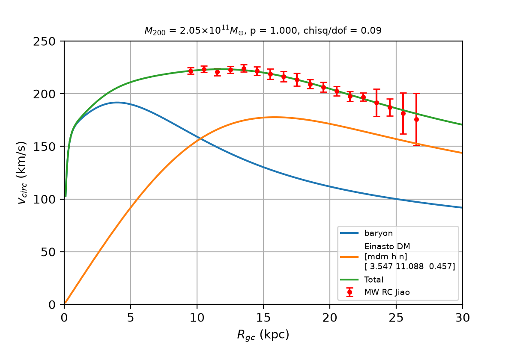
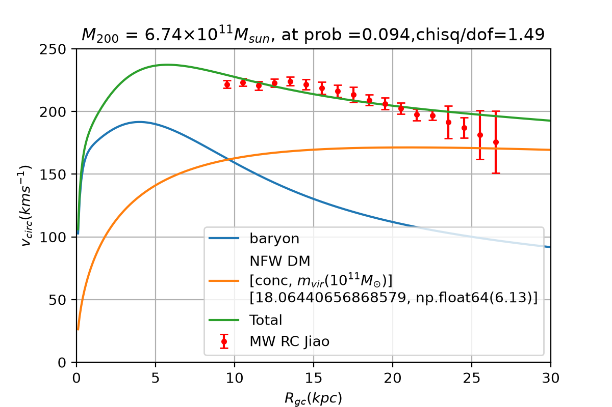

# Milky Way rotation-curve fit: NFW vs Einasto dark-matter halos

Reproduction of the rotation-curve fitting task from the **Milky Way dark matter workshop (Jan 2025)**. The script fits NFW and Einasto dark-matter halos to the Milky Way circular-velocity curve and, for each, also finds the heaviest halo the data cannot statistically rule out.

Author: Dipra Saha ([rapidFOX152](https://github.com/rapidFOX152))

## Result

Masses are M200 (baryons plus dark matter inside r200) in units of 10^11 M☉. All numbers come from one run with seed 42.

| Model | Case | M200 | chi² | p | Parameters |
|---|---|---|---|---|---|
| NFW | best fit | 6.74 | 23.79 | 0.094 | c = 18.03, mvir = 0.613 (galpy units, 10^12 M☉) |
| NFW | heaviest, p ≥ 0.01 | 9.21 | 32.00 | 0.010 | c = 13.68, mvir = 0.860 |
| Einasto | best fit | 2.05 | 1.31 | 1.000 | mdm = 3.55, h = 11.09 kpc, n = 0.457 |
| Einasto | heaviest, p ≥ 0.01 | 2.71 | 30.42 | 0.010 | mdm = 1.80, h = 7.56 kpc, n = 0.848 |

- The Einasto profile describes the declining outer rotation curve far better than NFW (chi² 1.3 against 23.8) and needs about a third of the mass. The Einasto best-fit mass of 2.05 × 10^11 M☉ matches the value reported by Jiao et al. 2023.
- Even the heaviest Einasto halo allowed by the data (2.71) is lighter than the best-fit NFW halo (6.74).
- The Einasto best fit has a very low chi² (p = 1.0). This is much better than the error bars predict, which suggests the uncertainties are conservative or correlated. Testing that is a natural extension (see below).

### Figures

| | |
|---|---|
| `fig0.png`: data and baryon curve | `fig1_nfw_best.png`: NFW best fit |
| `fig2_nfw_highmass.png`: heaviest allowed NFW | `fig3_einasto_best.png`: Einasto best fit |
| `fig4_einasto_highmass.png`: heaviest allowed Einasto | |

## Method

- **Model.** Circular speed is the baryon and dark-matter contributions added in quadrature, v² = v_bary² + v_DM². Halos are built with [galpy](https://github.com/jobovy/galpy): `NFWPotential` (parameters: concentration c and virial mass mvir) and an Einasto density profile ρ ∝ exp(−(r/h)^(1/n)) (parameters: amplitude mdm, scale radius h in kpc, index n).
- **Fit.** chi² against the observed curve, minimised with simulated annealing (Metropolis acceptance, with temperature and step size decreasing over the run).
- **Mass.** M200 is the mass inside the radius where the mean density is 200 times the critical density, plus the fixed baryonic mass of 0.61 × 10^11 M☉.
- **Heaviest halo.** Starting from the best fit, a random walk accepts a move only if the fit stays statistically acceptable (p ≥ 0.01, from the chi² survival function with data points minus parameters as degrees of freedom) and the halo gets heavier. The result marks the edge of what the data allow.

## Run it

```bash
pip install -r requirements.txt
python mw_rc_fit_complete.py
```

Run it from the repository folder, which must contain `rc_mw_jiao23.txt`, `v_bary_J23.npy` and `v_bary_b2_plot.npy`. It saves the five figures and prints a summary table. It takes several minutes; the two Einasto searches take most of the time.

The random walks are seeded (`SEED = 42`), so the numbers above reproduce exactly with the pinned package versions. Other seeds shift the heavy-halo masses slightly.

## Caveats

- The fits are stochastic optimisations, not MCMC: there are no parameter uncertainties or posteriors.
- Errors are treated as independent Gaussians, and the baryon model is held fixed.
- The heaviest-halo masses depend on the p ≥ 0.01 threshold and are a heuristic upper envelope, not a confidence interval.

## Possible extensions

- Model correlated systematic errors in the rotation curve and check whether the preference for Einasto over NFW survives.
- Compare simulation-based inference against MCMC or nested sampling on the same fit.

## Credits

- Task and workshop: "Introduction to Astrophysics Research: Milky Way's Dark Matter and Mass", Dhaka, Bangladesh, Jan 24-25, 2025.
- Rotation curve data: Jiao et al. 2023, *Detection of the Keplerian decline in the Milky Way rotation curve*.
- Baryonic contribution: de Salas et al. 2019, *On the estimation of the Local Dark Matter Density using the rotation curve of the Milky Way*.
- Halo potentials: galpy (Bovy 2015).

The workshop handout and the original task script are not included in this repository.

## Key figures



